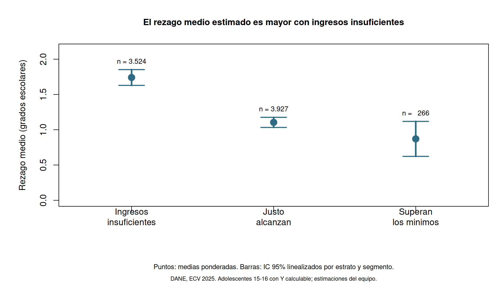

# Rezago educativo adolescente y condiciones familiares en Colombia

**Un estudio exploratorio e inferencial con microdatos de la Encuesta Nacional de Calidad de Vida (ECV) 2025.**

[](https://github.com/hernanchoporras-afk/evd-ecv2025/actions/workflows/analisis-ecv.yml)

## Una pregunta de interés público

La acumulación de rezago en la trayectoria escolar plantea un desafío para comprender las condiciones en las que adolescentes avanzan por el sistema educativo. Reconocer asociaciones entre trayectorias escolares y características de sus hogares puede ayudar a formular diagnósticos más precisos, pero requiere separar los patrones observados de lo que realmente permite inferir una encuesta.

> **Pregunta de negocio:** ¿Qué características económicas y familiares convendría priorizar en una caracterización diagnóstica inicial del rezago educativo de adolescentes de 15 y 16 años, para orientar el trabajo de la Subdirección de Permanencia del Ministerio de Educación Nacional?

Este proyecto investiga esa pregunta mediante datos públicos del **DANE**. El Ministerio es el *decisor de referencia del ejercicio*, no un patrocinador del estudio. **No se atribuye causalidad ni se proponen decisiones automáticas de intervención.**

## Qué investigamos

| Dimensión | Variable | Sentido de la comparación |
| --- | --- | --- |
| Resultado (`Y`) | Rezago en escolaridad alcanzada, medido en grados | Intensidad, no solo asistencia o inasistencia |
| Condición económica (`X`) | Suficiencia percibida de ingresos | Insuficientes, justo alcanzan, superan los gastos mínimos |
| Contexto laboral (`Z1`) | Ocupación del jefe del hogar | Ocupado frente a no ocupado |
| Composición familiar (`Z2`) | Menores de 18 años residentes | Un menor frente a dos o más |

El rezago es un **indicador construido por el equipo** a partir de la edad y la escolaridad reportada; **no es la medida oficial de extraedad del MEN**.

Se consideran dos especificaciones del indicador:

- **Principal:** `Y = max(0, edad - 6 - grados_aprobados)`.
- **Alternativa:** `Y_alt = max(0, edad - 7 - grados_aprobados)`.

La ECV 2025 es transversal: el estudio describe asociaciones, no mecanismos causales ni trayectorias individuales a lo largo del tiempo.

## Evidencia principal reproducida

| Indicador | Valor |
| --- | ---: |
| Adolescentes de 15–16 años identificados | 7.792 |
| Observaciones con rezago comparable | 7.717 |
| Comparación económica principal | 7.451 |
| Rezago medio ponderado, ingresos insuficientes | 1,741 grados |
| Rezago medio ponderado, ingresos que justo alcanzan | 1,104 grados |
| **Brecha estimada** | **0,636 grados** |
| **Intervalo de confianza del 95 %** | **[0,504; 0,768] grados** |
| Valor p bilateral | 5,25 × 10⁻²¹ |



**Lectura:** la insuficiencia económica percibida está asociada con un rezago medio mayor bajo la especificación estadística utilizada. La diferencia es detectada estadísticamente, pero su interpretación para decisiones educativas requiere discutir magnitud, cobertura, medición y explicaciones alternativas.

No justifica, por sí sola, asignar apoyos ni afirmar que los ingresos causen rezago.

La estimación utiliza factores de expansión, estratos y segmentos públicos de la ECV. La varianza se calcula mediante una **aproximación de encuesta compleja**, sin presentarla como reproducción exacta del estimador oficial del DANE.

[Consultar evidencia e incertidumbre](docs/evidencia.md).

## Profundización: ¿cambia la brecha según el contexto familiar?

Después del contraste principal se incorporó una profundización inferencial para estudiar si la asociación entre suficiencia percibida de ingresos y rezago educativo cambia según las características familiares.

Para ello se utilizaron modelos de regresión con diseño muestral aproximado mediante `survey::svyglm()`.

### Contrastes de interacción

Se estimaron las interacciones entre suficiencia económica y las variables familiares `Z1` y `Z2`, tanto con el indicador principal como con su definición alternativa.

| Contraste | Diferencia entre brechas | Valor p bilateral |
| --- | ---: | ---: |
| Ocupación del jefe (`Z1`) | +0,1374 | 0,4666 |
| Número de menores (`Z2`) | −0,1877 | 0,2673 |
| `Z1` con definición alternativa de rezago | +0,0393 | 0,8110 |
| `Z2` con definición alternativa de rezago | −0,1284 | 0,3911 |

**Hallazgo:** los contrastes no proporcionan evidencia estadística suficiente para afirmar que la brecha económica varíe entre las categorías familiares estudiadas.

Esto **no demuestra igualdad entre las brechas**. Los resultados indican que las diferencias estimadas entre ellas son compatibles con la incertidumbre del procedimiento empleado.

Las interacciones se consideran exploratorias, ya que las preguntas se formularon a partir de patrones previamente observados en los mismos microdatos. El análisis también incorpora corrección de Holm para las dos interacciones examinadas en cada definición del resultado.

### Modelos ajustados

Adicionalmente, se estimaron modelos aditivos para examinar las asociaciones económicas y familiares con el nivel medio de rezago.

Entre sus resultados:

- La brecha económica ajustada por `Z1` y `Z2` fue de aproximadamente **0,5969 grados**.
- Los hogares con dos o más menores presentaron una asociación ajustada de **0,2221 grados adicionales de rezago** frente a hogares con un menor.
- Para esta última asociación, el intervalo del 95 % fue **[0,0805; 0,3636]**, con **p = 0,0021**.

**Interpretación:** la composición familiar aporta información sobre diferencias en el nivel medio de rezago, incluso después del ajuste estadístico considerado. Sin embargo, no se identificó evidencia suficiente de que modifique la brecha económica entre los grupos de ingresos.

Los modelos ajustados no representan estimaciones causales y sus resultados dependen de la especificación y las variables incluidas.

### Sensibilidad y relevancia sustantiva

La comparación principal estimó una brecha de **0,6361 grados**, mientras que la definición alternativa del rezago produjo **0,5144 grados**.

El criterio de **0,5 grados** se utiliza como referencia operativa propuesta por el equipo, no como umbral oficial del MEN ni como regla de focalización.

La dirección positiva de la asociación se mantiene con ambas definiciones, pero no resulta robusto afirmar que su magnitud supere los 0,5 grados.

La sensibilidad metodológica y las interacciones familiares ayudan a delimitar las conclusiones, sin sustituir la validación educativa de la variable de rezago.

## De las preguntas a las decisiones

1. **Explorar:** ¿cómo varía la intensidad del rezago según suficiencia económica y condiciones del hogar?
2. **Inferir:** ¿cuál es la magnitud poblacional estimada de la brecha y qué incertidumbre la acompaña?
3. **Comprobar estabilidad:** ¿cambia la lectura al usar otra referencia de edad y grado?
4. **Profundizar:** ¿la asociación económica cambia según la ocupación del jefe o la cantidad de menores residentes?
5. **Complementar:** ¿qué información adicional aportan las condiciones familiares al ajustar las comparaciones?
6. **Decidir:** ¿qué dimensiones conviene conservar y qué evidencia adicional hace falta antes de utilizarlas institucionalmente?

La investigación respalda conservar la suficiencia percibida de ingresos (`P9090`) como dimensión económica de la caracterización inicial.

La composición familiar (`Z2`) y la ocupación del jefe (`Z1`) se mantienen como dimensiones contextuales, con distinto grado de evidencia sobre su asociación con el resultado.

No se incorporaron ACP, segmentación ni modelos predictivos únicamente por complejidad. Se priorizaron contrastes de interacción y modelos ajustados por su relación directa con las preguntas derivadas de la exploración.

**La decisión diagnóstica es provisional:** conservar las dimensiones informativas, validar la medición del rezago y evitar interpretaciones causales o reglas automáticas de atención individual.

## Explorar el repositorio

```text
.
├── .github/
│   └── workflows/
│       └── analisis-ecv.yml
│
├── codigo/
│   ├── parte1/
│   │   └── ECV2025_Parte1_UNICO.R
│   ├── 00_preparar_datos.R
│   ├── 01_inferencia.R
│   ├── 02_figuras.R
│   ├── 03_diagnosticos_diseno.R
│   ├── 04_potencia_futura.R
│   ├── 05_heterogeneidad_familiar.R
│   └── 06_profundizacion_y_figuras.R
│
├── datos/
│   └── Archivos originales de la ECV 2025
│
├── docs/
│   ├── metodologia.md
│   ├── evidencia.md
│   ├── registro_decisiones.md
│   └── figuras/
│
├── run/
│   ├── README.md
│   ├── analisis_completo.R
│   ├── verificar_insumos.R
│   └── verificar_resultados.R
│
└── README.md
```

### Responsabilidades de los scripts

| Script | Función |
| --- | --- |
| `00_preparar_datos.R` | Reconstrucción de variables e integración de microdatos |
| `01_inferencia.R` | Medias ponderadas, contraste principal y sensibilidad |
| `02_figuras.R` | Visualizaciones iniciales del análisis |
| `03_diagnosticos_diseno.R` | Auditoría del diseño muestral y sus supuestos |
| `04_potencia_futura.R` | Escenarios prospectivos de potencia y tamaño muestral |
| `05_heterogeneidad_familiar.R` | Contraste exploratorio inicial de interacción con `Z2` |
| `06_profundizacion_y_figuras.R` | Interacciones con `Z1` y `Z2`, modelos ajustados y figuras adicionales |

**Ruta de lectura sugerida:**

[Metodología](docs/metodologia.md) → [Evidencia](docs/evidencia.md) → [Registro de decisiones](docs/registro_decisiones.md) → [Ejecución reproducible](run/README.md).

## Reproducir el análisis

**Requisitos:**

- R instalado.
- Paquete [`survey`](https://cran.r-project.org/package=survey).
- Archivos originales de la ECV 2025 disponibles en `datos/`.

El programa contempla nombres de archivos con codificaciones irregulares identificadas en algunas descargas de Windows.

### Desde la terminal

Ejecutar desde la raíz del repositorio:

```bash
Rscript --vanilla run/analisis_completo.R
```

### Desde RStudio

```r
if (!requireNamespace('survey', quietly = TRUE)) {
  install.packages('survey')
}

source('run/analisis_completo.R', encoding = 'UTF-8')
```

El flujo completo:

1. Verifica los microdatos originales.
2. Reconstruye las variables y el marco de análisis.
3. Ejecuta la inferencia principal y los diagnósticos.
4. Calcula los escenarios prospectivos de potencia.
5. Estima las interacciones familiares.
6. Genera las figuras originales y complementarias.
7. Ejecuta las verificaciones automáticas de integridad.

Las salidas locales se almacenan en `resultados/` y `figuras/` y no se versionan.

### Desde GitHub Actions

También es posible ejecutar el procedimiento sin instalar R localmente:

1. Ingresar a la pestaña **Actions**.
2. Seleccionar **ECV 2025 | Evidencia reproducible**.
3. Ejecutar **Run workflow** sobre la rama `main`.
4. Esperar a que finalice el procedimiento.
5. Descargar el artefacto **`evidencia-ecv-2025`**.

El artefacto contiene las tablas, contrastes, controles y visualizaciones generadas por los scripts.

El flujo también verifica que se conserven los resultados principales y que los dos scripts de heterogeneidad produzcan estimaciones puntuales consistentes para `Z2`.

No se requiere semilla aleatoria, pues los procedimientos incorporados no utilizan remuestreo estocástico. Cada ejecución registra las versiones efectivas de R y los paquetes utilizados.

## Visualizaciones disponibles

Además de las figuras iniciales, la profundización incorporó nuevas visualizaciones:

| Archivo | Contenido |
| --- | --- |
| `01_distribucion_grupos.png` | Distribuciones muestrales sin ponderar |
| `01_distribucion_grupos_ponderada.png` | Distribuciones ponderadas de rezago |
| `02_medias_ponderadas_ic95.png` | Medias ponderadas e intervalos del 95 % |
| `03_contraste_diseno_vs_welch.png` | Comparación de procedimientos inferenciales |
| `04_forest_sensibilidad_Y.png` | Sensibilidad a la definición del rezago y referencia de 0,5 grados |
| `05_brechas_familiares_ponderadas.png` | Brechas económicas por condición familiar |
| `06_diferencia_entre_brechas.png` | Contrastes directos de heterogeneidad |

Todas las visualizaciones se generan mediante R a partir de los microdatos y los estimadores calculados.

## Fuentes, límites y responsabilidad académica

- **Fuente primaria:** [DANE, ECV 2025 y microdatos](https://microdatos.dane.gov.co/index.php/catalog/905).
- **Marco de variables:** [Diccionario ECV 2025](https://microdatos.dane.gov.co/index.php/catalog/905/data-dictionary).
- **Método de recolección:** [Metodología general ECV 2025](https://www.dane.gov.co/files/operaciones/ECV/met-ECV-2025.pdf).
- **Contexto educativo:** [MEN, indicador de extraedad](http://bi.mineducacion.gov.co:8380/eportal/web/sineb/f5.-extraedad).
- **Código y decisiones:** elaborados por el equipo investigador; no constituyen publicaciones oficiales del DANE ni del MEN.

Los resultados se interpretan bajo una aproximación declarada al diseño muestral complejo de la ECV y están sujetos a limitaciones de medición, cobertura, selección de hipótesis y ausencia de seguimiento longitudinal.

El estudio forma parte de **Exploración y Visualización de Datos para lo Socioeconómico (MECA-4603)**.

Su alcance actual es la exploración, la inferencia estadística, la sensibilidad de los resultados, la profundización familiar y la formulación de decisiones diagnósticas respaldadas por evidencia.

El diseño de un tablero interactivo corresponde a una etapa posterior y no constituye un entregable de esta fase.

**Equipo:** Hernán Felipe Yepes, Martín Santiago Gonzales y Jaime Alejandro Parra.
