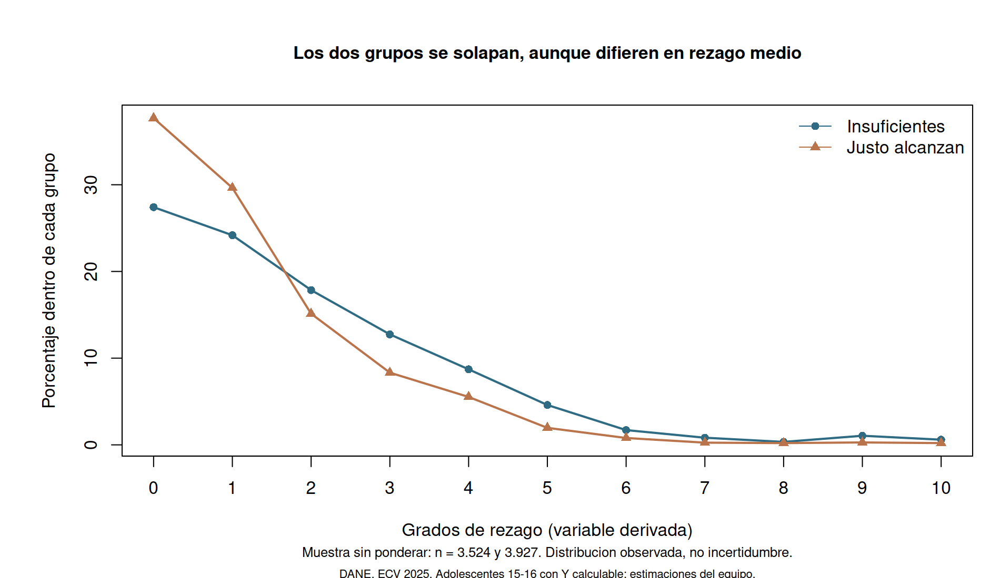
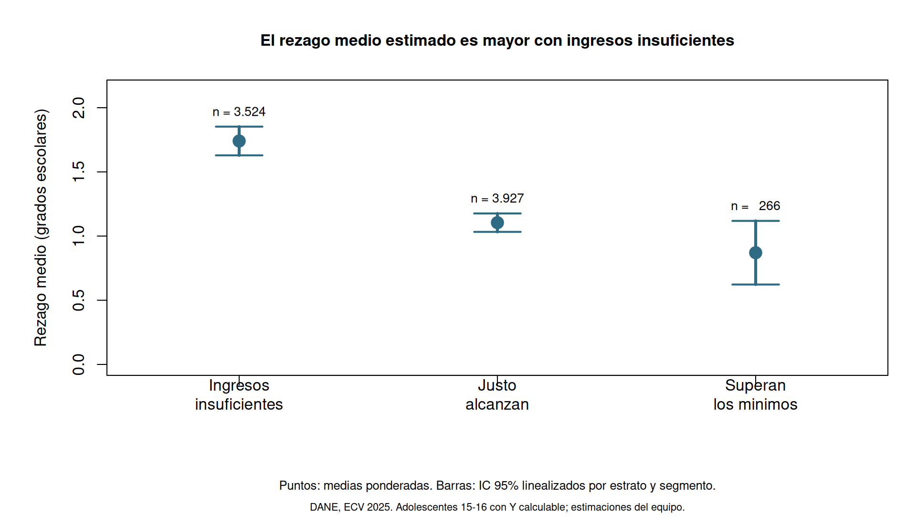
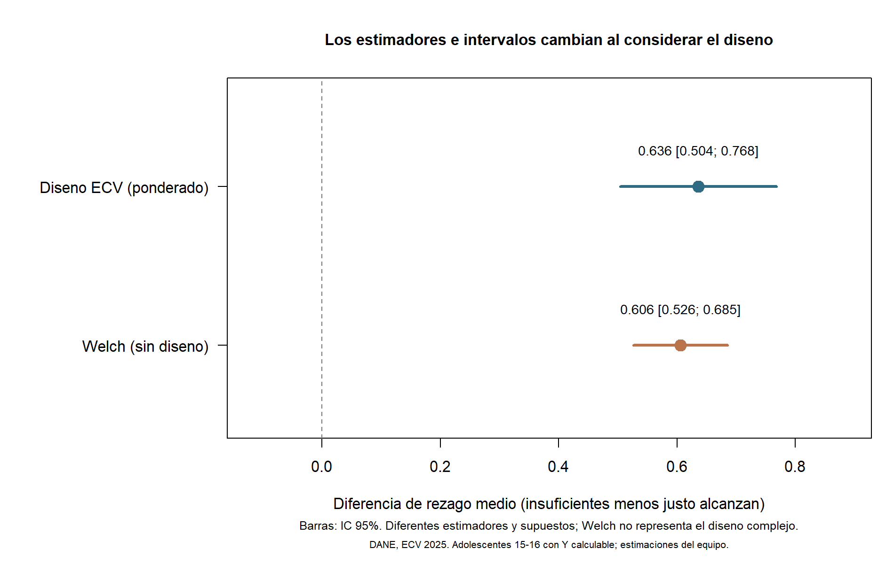

# De la evidencia a la decisión diagnóstica

El objetivo de este estudio no es clasificar beneficiarios ni proponer una intervención definitiva, sino **precisar qué dimensiones conviene conservar y estudiar en una caracterización inicial del rezago educativo adolescente**. Los microdatos de la ECV 2025 permiten identificar asociaciones, no establecer causas.

## 1. ¿Qué mostraba la exploración descriptiva?

En la muestra de adolescentes de 15 y 16 años con un indicador comparable, el rezago medio **sin ponderar** fue de **1,9004 grados** en hogares que declararon ingresos insuficientes y de **1,2949 grados** en aquellos cuyos ingresos justo alcanzan: diferencia descriptiva **0,6055**.

*Figura 1. Distribución observada, sin ponderación, por grado de rezago derivado (0–10). Muestras: 3.524 adolescentes con ingresos insuficientes y 3.927 cuyos ingresos justo alcanzan. Eje vertical: porcentaje **dentro de cada grupo**, no error ni intervalo de confianza. Fuente: DANE, ECV 2025; procesamiento del equipo. No se observan trayectorias temporales.*

**Lectura:** ambas distribuciones se superponen, de modo que pertenecer a una categoría económica no determina el grado de rezago de un adolescente. El patrón motivó estimar una diferencia poblacional y su incertidumbre, no comparar únicamente dos promedios muestrales.

## 2. ¿Existe evidencia de una diferencia media poblacional?

### Muestra y exclusiones

| Suficiencia de ingresos (`P9090`) | n con `Y` calculable | n excluidos por `Y` no comparable |
| --- | ---: | ---: |
| Insuficientes | 3.524 | 26 |
| Justo alcanzan | 3.927 | 47 |
| Superan gastos mínimos | 266 | 2 |
| **Total** | **7.717** | **75** |

La comparación inferencial principal usa **n = 7.451** (primeras dos categorías). Su dominio representa **4.736 pares estrato–segmento** en los **356 estratos** del marco, con dos estratos que contienen un solo segmento observado en ese dominio. La declaración completa del diseño contiene **8.543 segmentos** y **8.187 grados de libertad nominales**. Estos recuentos no deben confundirse con 7.451 personas independientes.

### Medias ponderadas e incertidumbre

| Categoría | Media ponderada | EE de la media | IC del 95 % |
| --- | ---: | ---: | --- |
| Ingresos insuficientes | **1,7405** | 0,05708 | [1,6286; 1,8524] |
| Justo alcanzan | **1,1044** | 0,03657 | [1,0327; 1,1761] |
| Superan gastos mínimos | **0,8703** | 0,12645 | [0,6224; 1,1182] |

*Figura 2. Puntos: medias ponderadas del indicador derivado `Y` (grados). Barras: IC del 95 % mediante la linealización y el diseño público aproximado con estratos, segmentos y `FEX_C`. `n` identifica personas encuestadas, no población expandida. Fuente: DANE, ECV 2025; estimaciones del equipo. El solapamiento de las barras individuales no sustituye el contraste de la diferencia.*

### Contraste bilateral principal

| Estadístico | Resultado en R |
| --- | ---: |
| Parámetro | Diferencia de medias (insuficientes − justo alcanzan) |
| Estimación | **0,6361267 grados** |
| Error estándar | **0,06745978** |
| IC del 95 % de la diferencia | **[0,5038884; 0,7683650]** |
| Estadístico t | **9,429718** |
| Grados de libertad utilizados | **8.187** |
| Valor p bilateral | **5,253914 × 10⁻²¹** |
| Regla | Bilateral, `α = 0,05` |
| Procedimiento | `survey::svyglm(Y ~ insuf)` sobre dominio del diseño declarado |

**Decisión estadística frente a H₀.** Bajo la especificación de diseño y su aproximación t se **rechaza H₀: Δ = 0**. Existe evidencia de una diferencia positiva entre medias poblacionales de los dos grupos. El valor p expresa incompatibilidad con una diferencia exactamente nula bajo los supuestos del contraste; no mide la probabilidad de que H₀ sea verdadera.

**Significado sustantivo, por separado.** La brecha estimada es de aproximadamente **0,64 grados de rezago medio**, no significa que todos los adolescentes del primer grupo estén retrasados en la misma magnitud. La asociación favorece **conservar la suficiencia de ingresos percibida como dimensión del diagnóstico**, pero por sí sola no selecciona beneficiarios ni demuestra que mejorar los ingresos causaría una reducción del rezago.

## 3. ¿Por qué no sustituir el análisis por Welch?

| Procedimiento | Diferencia | EE | IC del 95 % |
| --- | ---: | ---: | --- |
| Diseño especificado con pesos | **0,6361** | 0,06746 | [0,5039; 0,7684] |
| Welch sin ponderación ni conglomeración | **0,6055** | 0,04056 | [0,5260; 0,6850] |

*Figura 3. Diferencias de medias e IC del 95 % estimados sobre los mismos 7.451 adolescentes. La primera especificación usa pesos, estratos y segmentos; Welch es una comparación sin ponderación ni dependencia intrasegmento. **Cambian el estimador y las hipótesis de varianza a la vez**. Fuente: DANE, ECV 2025; cálculos del equipo.*

**Decisión de método:** se mantiene la especificación basada en el diseño público como procedimiento principal. Welch **no constituye una validación independiente**, no representa el mismo estimando poblacional y su menor EE no demuestra mayor confiabilidad.

## 4. ¿La magnitud supera la referencia diagnóstica de 0,5 grados?

**Referencia del equipo:** `δ* = 0,5` grados, propuesta con fines de valoración diagnóstica agregada. No es un criterio establecido por MEN, DANE, OCDE u otra institución; se fundamenta como una diferencia equivalente a 50 grados adicionales de rezago acumulado por cada 100 adolescentes, bajo el mismo indicador. **La relevancia específica de 0,5 es una decisión interpretativa, no un hallazgo de la literatura.**

| Construcción del rezago | Diferencia ponderada | IC del 95 % |
| --- | ---: | --- |
| `max(0, edad - 6 - grados_aprobados)` | **0,6361** | [0,5039; 0,7684] |
| `max(0, edad - 7 - grados_aprobados)` | **0,5144** | [0,4002; 0,6285] |

**Hallazgo:** la dirección de la asociación se conserva, pero la diferencia se reduce aproximadamente **0,1218 grados (19,1 %)** al utilizar la segunda referencia. El intervalo de esta alternativa incluye magnitudes inferiores a 0,5; por tanto **no es defendible afirmar que la brecha supere robustamente el criterio de 0,5 grados**. El intervalo principal, cuyo límite inferior es aproximadamente 0,5039, tampoco deja un margen cómodo sobre esa referencia.

**Decisión diagnóstica:** conservar `P9090` para el análisis, pero evitar convertir la cifra en un criterio rígido de focalización o en una prueba de importancia institucional ya establecida. La prioridad de cada variable debería revisarse con las covariables familiares y con una medición educativa validada.

## 5. ¿Qué control de calidad y potencia faltaba?

La ejecución del 19 de noviembre de 2026 confirmó: **235.350** personas en el archivo de diseño, **8.543** segmentos en **356** estratos del marco, `FEX_C` positivo y finito, **4.736** segmentos del dominio principal y **dos estratos con un único segmento observado en ese dominio**. El archivo `05_diagnosticos_diseno.csv` registra estos controles. La sensibilidad del tratamiento de unidades solitarias (`07_sensibilidad_solitarios.csv`) fue efectivamente ejecutada: el error estándar pasó de **0,0674597832** a **0,0674598149**, una diferencia de **0,0000000317 grados**. El contraste principal sigue estimando **0,6361267 grados** en ambas especificaciones. Esta estabilidad se refiere solo al ajuste examinado y no valida por sí misma la reconstrucción integral del diseño DANE.

Para la **planificación de una encuesta futura**, y **no** como potencia retrospectiva, el equipo plantea un escenario hipotético: `δ* = 0,5`, `α = 0,05`, desviación de planificación de **1,7261** grados (piloto ECV), grupos equilibrados y efecto de diseño **supuesto** de 2. Con aproximación normal, se requieren aproximadamente **375 personas por grupo para 80 % de potencia** o **501 por grupo para 90 %**. La validez de estos valores depende de los supuestos de diseño y de la proporción real de respuestas; no son cálculos oficiales de DANE.

Los archivos `resultados/inferencia/03_potencia_futura.csv`, `04_escenarios_potencia.csv` y los diagnósticos `05`–`08` se generaron y verificaron en el artefacto `evidencia-ecv-2025` de GitHub Actions. Las muestras de planificación son escenarios hipotéticos, no potencias retrospectivas ni tamaños muestrales oficiales.

## 6. ¿Qué decisión cambia y cuál es la siguiente pregunta?

| Pregunta | Hallazgo | Implicación para el diagnóstico | Próximo contraste |
| --- | --- | --- | --- |
| ¿Existe brecha por ingresos percibidos? | Diferencia positiva, 0,6361 [0,5039; 0,7684] | Conservar `P9090` como variable de caracterización | Examinar composición y contexto familiar |
| ¿El resultado depende de la medida? | Diferencia alternativa 0,5144 [0,4002; 0,6285] | No sostener magnitud > 0,5 de modo robusto | Revisar la definición de escolaridad, exclusiones y sensibilidad |
| ¿Hay diferencias entre hogares? | La Parte 1 sugiere heterogeneidad exploratoria | Conservar `Z1` y `Z2` como preguntas, no como criterios automáticos | Probar **directamente** interacciones/diferencias de brechas con diseño si el equipo lo justifica |

**Siguiente pregunta:** ¿la asociación de suficiencia económica percibida con el rezago tiene magnitudes distintas según la ocupación del jefe y el número de menores residentes, o la heterogeneidad observada se debe a variación muestral y composición de hogares?

**Límites:** estudio transversal; rezago construido por el equipo; percepción subjetiva de ingresos; resultados exploratorios sobre datos previamente examinados; incertidumbre condicionada al diseño operativo de USM y estratos, sin reproducción completa de las dos etapas de la ECV; no hay identificación causal. La etapa complementaria del equipo se incorporará únicamente cuando sus resultados y justificación sean reproducibles.

### Fuentes de contexto y método

- [DANE, metadatos ECV 2025](https://microdatos.dane.gov.co/index.php/catalog/905).
- [MEN, ficha de tasa de extraedad](https://portalsineb.mineducacion.gov.co/1782/articles-412165_Trayectoria_05_V2024.pdf).
- [OCDE, Education at a Glance 2024: equidad y extraedad](https://www.oecd.org/en/publications/education-at-a-glance-2024_c00cad36-en/full-report/equity-in-the-education-sustainable-development-goal_9d94cd1e.html).
- [Lumley (2004), análisis de encuestas complejas](https://doi.org/10.18637/jss.v009.i08).
- [Documentación técnica y plan prospectivo del proyecto](metodologia.md).
